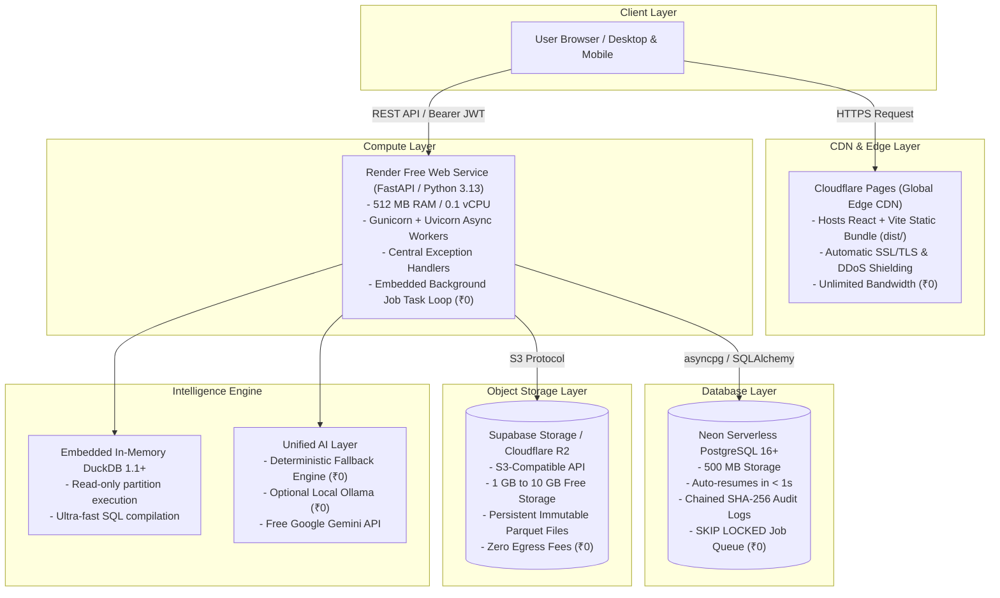

# DataLens 1.0 – Free-Tier Production Deployment Architecture

## 1. System Topology & Data Flow

DataLens 1.0 is architected for zero-cost operational resilience. The platform decouples static asset delivery from backend query compute, and transactional state from immutable analytical storage:



---

## 2. Component Specifications

### 2.1 Frontend: Cloudflare Pages
- **Technology**: React 18, Vite 6, Tailwind CSS, TypeScript.
- **Build Output**: Static assets compiled to `dist/` (HTML, JS, CSS, SVG).
- **Deployment Mechanism**: Direct Git integration (GitHub repository) or direct upload via Wrangler CLI.
- **Routing**: Single Page Application (SPA) rewrite rule (`/* -> /index.html`).
- **Cost**: **₹0.00 / Month**.

### 2.2 Backend API: Render Free Web Service
- **Technology**: Python 3.13, FastAPI, Gunicorn, Uvicorn Worker, AsyncIO.
- **Execution Command**:
  ```bash
  gunicorn app.main:app -w 2 -k uvicorn.workers.UvicornWorker --bind 0.0.0.0:$PORT --timeout 120
  ```
- **Port**: Dynamically bound via `$PORT` environment variable provided by Render.
- **Cold-Start Handling**: Keep-alive ping to `/api/v1/health` or graceful client-side loading indicator.
- **Cost**: **₹0.00 / Month**.

### 2.3 Relational Metadata: Neon Serverless PostgreSQL
- **Engine**: PostgreSQL 16/18 with SSL encryption.
- **Driver**: `asyncpg` via SQLAlchemy 2.0.
- **Schema Management**: Alembic migrations executed automatically during service build/start (`alembic upgrade head`).
- **Connection Tuning**:
  ```python
  pool_size = 5
  max_overflow = 10
  pool_recycle = 1800
  pool_pre_ping = True
  ```
- **Cost**: **₹0.00 / Month**.

### 2.4 Analytical Storage: Supabase Storage / Cloudflare R2
- **Protocol**: S3-Compatible API.
- **Storage Layout**:
  - `datasets/{dataset_id}/{version_id}/part_*.parquet`
  - `datasets/{dataset_id}/{version_id}/manifest.json`
  - `reports/{report_id}/{run_id}/artifact.pdf`
- **Cost**: **₹0.00 / Month**.

### 2.5 In-Process Background Task Loop
- **Pattern**: Non-blocking background job claimer running inside the FastAPI lifespan context.
- **Execution**: Claims tasks using PostgreSQL atomic row locking:
  ```sql
  SELECT * FROM background_jobs 
  WHERE status = 'QUEUED' AND scheduled_at <= NOW()
  ORDER BY priority DESC, created_at ASC
  LIMIT 1 FOR UPDATE SKIP LOCKED;
  ```
- **Benefits**: Zero extra containers, zero extra cost, eliminates duplicate scheduler triggers.
- **Cost**: **₹0.00 / Month**.

---

## 3. Network Security & Ingress Policies

1. **CORS Allowlist**: Set `CORS_ORIGINS="https://<your-project>.pages.dev"`. Wildcards are prohibited.
2. **Encrypted Transport**: All inter-service communications enforce TLS 1.3 / HTTPS.
3. **Cookie Security**: `HttpOnly=True`, `SameSite=Lax`, `Secure=True` enforced in production mode.
4. **Credential Masking**: All third-party data source credentials encrypted with AES-256 before insertion into PostgreSQL.

