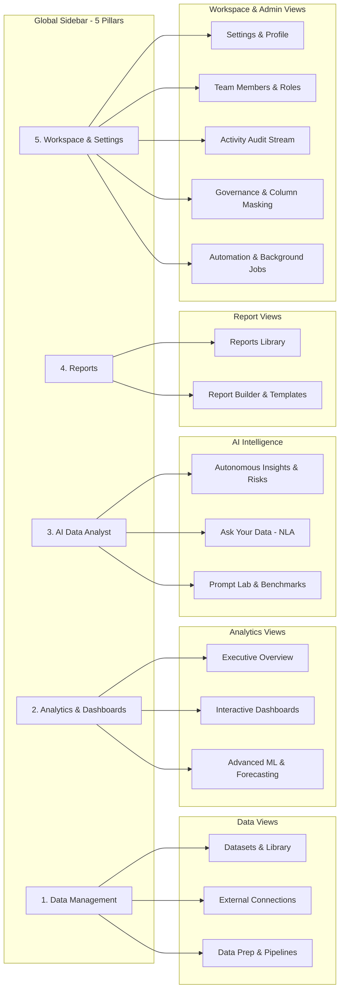

# DataLens 1.0 – Navigation Structure & Information Architecture

## 1. Overview & Navigation Philosophy

DataLens 1.0 enforces a strict **Two-Tier Information Architecture**:
- **Tier 1 (Global Sidebar)**: Contains **exactly five primary functional pillars**, accessible from anywhere in the application.
- **Tier 2 (Contextual Module Header)**: Features an integrated horizontal sub-navigation pill bar (`ModuleSubNav.tsx`) providing 1-click access to all specialized sub-views within the active pillar.

This two-tier structure eliminates navigation sprawl while preserving 100% of the underlying pages and capabilities.

---

## 2. Detailed Navigation Mapping

### Module 1: Data Management
- **Primary Sidebar Entry**: `/data` (Icon: `Database`)
- **Sub-paths Covered**: `/data`, `/data/:datasetId`, `/data-sources`, `/data-sources/:connectionId`, `/data-preparation`, `/data-preparation/:pipelineId`
- **Sub-Nav Tabs**:
  1. **Datasets & Library** (`/data`): Browse uploaded datasets, inspect row/column counts, review quality scores, and upload new files.
  2. **External Connections** (`/data-sources`): Manage connections to PostgreSQL, MySQL, Google Sheets, REST APIs, MongoDB, and AWS S3 with scheduled syncs.
  3. **Data Prep & Cleaning** (`/data-preparation`): Visual data pipelines, multi-step filter, formula, aggregate operations, and derived immutable datasets.

### Module 2: Analytics & Dashboards
- **Primary Sidebar Entry**: `/dashboards` (Icon: `LayoutDashboard`)
- **Sub-paths Covered**: `/dashboard`, `/dashboards`, `/dashboards/:dashboardId`, `/advanced-analytics`
- **Sub-Nav Tabs**:
  1. **Overview** (`/dashboard`): Executive KPI summary, first-time user 5-step workflow guide, and active dataset shortcuts.
  2. **Dashboards** (`/dashboards`): Full dashboard library, drag-and-drop grid editor, chart configurator, and drill-down filters.
  3. **Advanced ML & Forecasting** (`/advanced-analytics`): Comparative cohort analytics, time-series forecasting, and anomaly detection.

### Module 3: AI Data Analyst
- **Primary Sidebar Entry**: `/business-analyst` (Icon: `Sparkles`, Badge: `AI`)
- **Sub-paths Covered**: `/business-analyst`, `/ask`, `/prompt-lab`, `/prompt-lab/experiments/:id`
- **Sub-Nav Tabs**:
  1. **Autonomous Insights & Risks** (`/business-analyst`): Proactive trend discovery, concentration risk analysis, opportunity engine, and insight lifecycle status tracking.
  2. **Ask Your Data** (`/ask`): Natural language conversational BI, evidence-backed answer generation, analytical SQL plan inspection, and saved analyses.
  3. **Prompt Lab & Benchmarks** (`/prompt-lab`): Prompt engineering sandbox, model accuracy comparison, and prompt versioning.

### Module 4: Reports
- **Primary Sidebar Entry**: `/reports` (Icon: `FileText`)
- **Sub-paths Covered**: `/reports`, `/reports/new`, `/reports/:reportId`, `/reports/:reportId/preview`, `/reports/:reportId/history`
- **Sub-Nav Tabs**:
  1. **Report Library** (`/reports`): View generated reports, export statuses, format badges, and download triggers.
  2. **Create Report** (`/reports/new`): Executive summary builder, section configurator, and multi-format exporter (PDF, DOCX, XLSX, CSV).

### Module 5: Workspace & Settings
- **Primary Sidebar Entry**: `/settings` (Icon: `Settings`)
- **Sub-paths Covered**: `/settings`, `/workspaces/members`, `/activity`, `/governance`, `/automation`
- **Sub-Nav Tabs**:
  1. **Settings** (`/settings`): Workspace preferences, AI provider routing (Gemini / Ollama / Deterministic), and privacy toggles.
  2. **Team Members** (`/workspaces/members`): User management, role assignments (Owner, Admin, Editor, Viewer), and pending invitations.
  3. **Activity Stream** (`/activity`): Real-time collaborative workspace audit trail, discussion threads, and notifications.
  4. **Governance & Security** (`/governance`): Custom RBAC roles, column masking policies, and cryptographic chained SHA-256 audit log verification.
  5. **Automation & Jobs** (`/automation`): PostgreSQL SKIP LOCKED background job monitoring, retry inspection, and worker status.

---

## 3. Keyboard Shortcuts & Quick Navigation

- `Ctrl + K` / `Cmd + K`: Global search modal accessing datasets, dashboards, reports, and settings instantaneously.
- Mobile Hamburger: Triggers responsive side drawer preserving the exact same 5-pillar structure.
