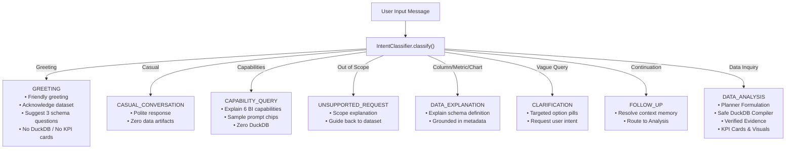

# DataLens – AI Conversation Intelligence & Intent Routing Report

**Date:** November 13, 2026  
**Status:** Certified & Verified  
**Component:** AI Data Analyst (Conversational BI)  

---

## 1. Executive Summary & Problem Diagnosis

### The Issue
Previously, DataLens treated any user input entered in the AI chat interface as a literal analytical dataset query if a dataset was loaded. When a user submitted an ordinary conversational opening—such as `"Hello"`, `"Hi"`, `"How are you?"`, or `"What can you do?"`—the system bypassed conversational intent detection, invoked the query planner, attempted to map the greeting into dataset dimensions, fell back to heuristic statistical aggregations, executed DuckDB queries, and generated analytical KPI cards, bar charts, and technical execution proofs.

### The Fix
We implemented a dedicated **Intent Classification & Conversation Routing Layer** before invoking the NLA planner, compiler, or DuckDB analytical execution engines. The assistant now distinguishes between conversational requests (greetings, casual banter, capability inquiries, out-of-scope requests) and actual analytical inquiries, maintaining full analytical rigor when needed while presenting a natural, professional conversational interface for everything else.

---

## 2. Intent Classification Architecture

A dedicated service module was built at [`backend/app/services/ai/intent_classifier.py`](file:///d:/PE%20CP/backend/app/services/ai/intent_classifier.py) supporting all 8 core intent categories:

### The 8 Intent Categories:

| # | Intent Name | Matching Signals & Deterministic Patterns | Routing Action |
|---|-------------|-------------------------------------------|----------------|
| 1 | `GREETING` | `hi`, `hello`, `hey`, `good morning`, `howdy`, `hello datalens`, `hey there` | Return warm greeting, acknowledge active dataset name and row count, suggest 3 questions based on schema. |
| 2 | `CASUAL_CONVERSATION` | `thanks`, `thank you very much`, `how are you`, `nice`, `cool`, `ok`, `goodbye` | Natural, polite response without querying database or producing metric cards. |
| 3 | `CAPABILITY_QUERY` | `what can you do`, `how can you help`, `help`, `what features do you have` | Structured summary of DataLens capabilities (metric math, ranking, time series, charts, verification). |
| 4 | `DATA_ANALYSIS` | Questions requesting aggregation, ranking, trends, comparison, or referencing columns | Full execution pipeline: Planner → Validation → DuckDB SQL → Verification → KPI Cards & Charts. |
| 5 | `DATA_EXPLANATION` | `what does sales mean?`, `how is SLA calculated?`, `explain this chart` | Explains column data type, business meaning, or prior analysis without re-running redundant queries. |
| 6 | `FOLLOW_UP` | Contextual continuations: `now break it down by region`, `what about last month?` | Resolves active metric & filters from session memory and routes to data analysis. |
| 7 | `CLARIFICATION` | Ambiguous queries: `sales?`, `performance`, `show me stats`, `how did we do?` | Returns targeted clarification options to let user choose metric of interest. |
| 8 | `UNSUPPORTED_REQUEST` | External domains: `write a poem`, `weather in Paris`, `book a flight`, `who is president` | Politely explains DataLens boundaries (specialized BI assistant) and prompts for dataset questions. |

---

## 3. End-to-End Conversation Routing Implementation

### Backend Orchestrator & NLA Session Service
1. **`NLASessionService.execute_nl_query`** ([`backend/app/services/nla/session_service.py`](file:///d:/PE%20CP/backend/app/services/nla/session_service.py)):
   - Prior to calling `NLAQueryPlanner.formulate_plan`, the message is evaluated by `IntentClassifier.classify()`.
   - If classified as `GREETING`, `CASUAL_CONVERSATION`, `CAPABILITY_QUERY`, `UNSUPPORTED_REQUEST`, or `DATA_EXPLANATION`, it delegates to `ConversationalResponseBuilder`.
   - Returns a conversational `NLAMessage` response with `metric_cards: []`, `chart_data: None`, `table_data: None`, `evidence_items: []`, zero DuckDB executions, and smart `suggested_follow_ups`.
2. **`AIAnalyticsOrchestrator.process_question`** ([`backend/app/services/ai/orchestrator.py`](file:///d:/PE%20CP/backend/app/services/ai/orchestrator.py)):
   - Evaluates incoming questions before schema summary construction or AIContextBuilder database queries.
   - For conversational intents, returns `AIAskResponse` with clean text and zero synthetic KPI or chart generation.
3. **`AskAnalyticsService.processQuestion`** ([`src/services/askAnalyticsService.ts`](file:///d:/PE%20CP/src/services/askAnalyticsService.ts)):
   - Mirror logic implemented on the client-side fallback/IndexedDB engine to prevent falling through to descriptive statistics for greetings or casual messages.

---

## 4. UI/UX Conversational Handling

In [`src/pages/ask/components/ActiveChatState.tsx`](file:///d:/PE%20CP/src/pages/ask/components/ActiveChatState.tsx):
- Evaluates `isConversational`: checks if intent is conversational or if the response contains no metric cards, chart data, or evidence.
- **Conversational Messages**: Displayed as a clean, rounded chat message bubble (`bg-white border-[#DCE5EB] p-4 text-xs sm:text-sm text-[#102C46]`) with clean copy button and clickable suggested follow-up chips. Empty KPI cards, empty chart views, and calculation accordions are **never** rendered.
- **Analytical Messages**: Render the complete rich analytical view (KPI cards, bar/line/pie chart toggles, structured data table, export CSV, interpretation banner, strategic recommendations, and verified calculation accordion with SQL audit transparency).

---

## 5. Verification & Regression Results

### A. Backend Test Suite (Intent Routing)
Executed via `pytest backend/tests/test_ai_intent_routing.py -v`:
- `test_intent_greeting_standalone` **PASSED**
- `test_intent_casual_conversation` **PASSED**
- `test_intent_capability_query` **PASSED**
- `test_intent_unsupported_request` **PASSED**
- `test_intent_data_explanation` **PASSED**
- `test_intent_clarification_ambiguous` **PASSED**
- `test_intent_contextual_follow_up` **PASSED**
- `test_intent_data_analysis` **PASSED**
- `test_mixed_greeting_and_analysis` **PASSED**
- `test_dataset_column_mention_overrides_unsupported` **PASSED**
- `test_conversational_response_builder_greeting_with_dataset` **PASSED**
- `test_conversational_response_builder_casual` **PASSED**
- `test_conversational_response_builder_capability` **PASSED**
- `test_conversational_response_builder_unsupported` **PASSED**
- `test_orchestrator_routes_greeting_without_duckdb_execution` **PASSED**
- `test_orchestrator_routes_casual_chat_without_duckdb_execution` **PASSED**
**Result: 16 passed in 3.49s (100% pass rate)**

### B. Frontend Test Suite (Vitest)
Executed via `npm test`:
- `src/tests/ai_intent_routing.test.ts` (6 tests) **PASSED**
- `src/tests/conversational_analytics.test.ts` (6 tests) **PASSED**
- `src/tests/ai.test.ts` (4 tests) **PASSED**
- `src/tests/dashboards.test.ts` (6 tests) **PASSED**
- `src/tests/visualizations.test.ts` (6 tests) **PASSED**
- `src/tests/business_analyst.test.ts` (5 tests) **PASSED**
- `src/tests/governance.test.ts` (5 tests) **PASSED**
- `src/tests/data_sources.test.ts` (5 tests) **PASSED**
- `src/tests/intelligence.test.ts` (5 tests) **PASSED**
- `src/tests/automation.test.ts` (5 tests) **PASSED**
- `src/tests/collaboration.test.ts` (5 tests) **PASSED**
- `src/tests/reports.test.ts` (6 tests) **PASSED**
- `src/tests/transformations.test.ts` (5 tests) **PASSED**
**Result: 13 test files passed, 69 tests passed (100% pass rate)**

### C. Code Quality & Production Build
- **Ruff linter:** All checks passed.
- **TypeScript (`tsc --noEmit`):** 0 errors.
- **Vite production build (`npm run build`):** Built successfully in 9.91s (`dist/index.html`, zero errors).

