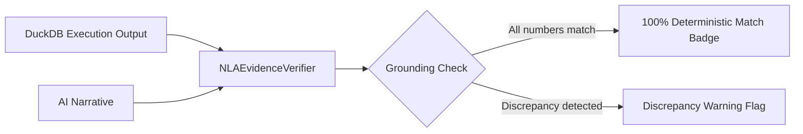

# Evidence-Backed Answers & Hallucination Prevention

## Verification Architecture
To ensure enterprise trustworthiness, DataLens strictly separates:
- **Direct calculated facts**: Deterministic numbers from DuckDB.
- **AI explanation**: Contextual narrative generated by Gemini or Ollama.
- **Business inferences**: Analytical deductions derived from the calculated facts.
- **Strategic recommendations**: Prescriptive business actions.

## Numerical Evidence Grounding
`NLAEvidenceVerifier` inspects all numbers appearing in the AI narrative. If an AI provider introduces numbers not present in the calculated metrics or data rows, the discrepancy is flagged to protect users from hallucinations.

## Transparency Accordion
Every analytical answer includes a "How this was calculated" transparency drawer showing:
- Verified KPI cards with trend indicators.
- Source columns and aggregation formulas.
- Number of records analyzed in Parquet storage.
- Compiled DuckDB SQL query.
- Execution duration in milliseconds.
- Deterministic verification badge.

