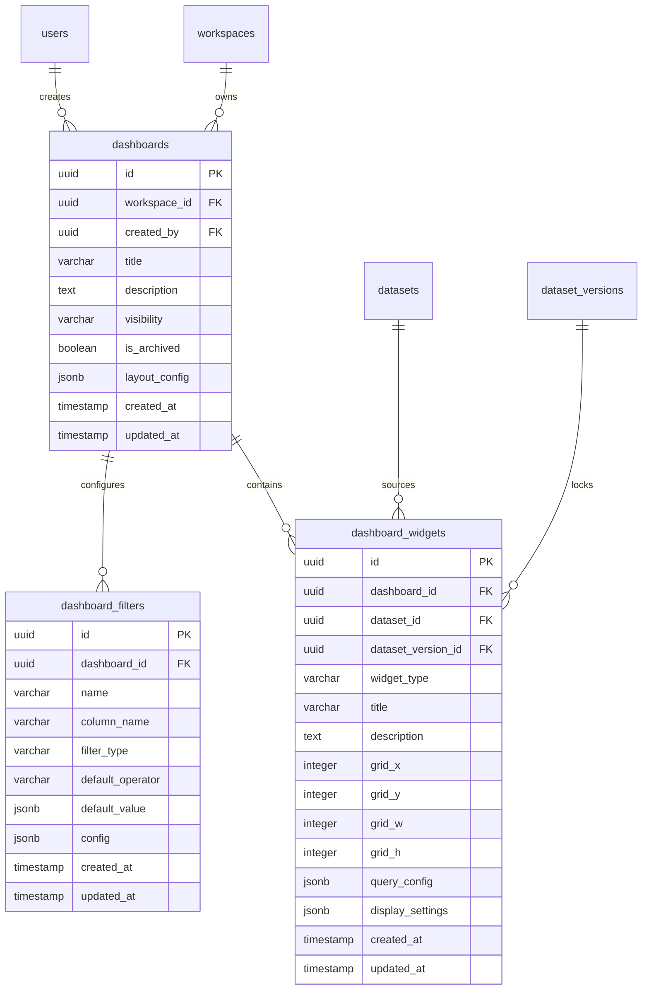

# DataLens — Phase 4A Architecture: Interactive Dashboard Builder

## 1. Executive Summary & Objective

DataLens Phase 4A introduces an enterprise-grade **Interactive Dashboard Builder** enabling business users, analysts, and workspace stakeholders to assemble, configure, customize, and share persistent analytical dashboards.

Building on the existing foundation:
- **Frontend:** React 18, TypeScript, Vite, Tailwind CSS, Lucide icons, pure responsive SVG chart primitives.
- **Backend:** FastAPI, Python 3.13, SQLAlchemy 2.0 Async ORM, PostgreSQL 18, Alembic migrations.
- **Analytics Engine:** In-process DuckDB executing against partitioned, immutable Parquet dataset files.
- **Security & Multi-Tenancy:** Workspace-scoped RBAC (`owner`, `admin`, `editor`, `viewer`) with JWT session management.

---

## 2. Reusable Architecture & Component Audit

### 2.1 Backend Reusable Services
1. **Analytics Engine (`app.services.analytics.engine.AnalyticsEngine`):**
   - In-memory DuckDB query runner with sanitized SQL identifiers and parameterized filter builders.
   - `compute_aggregation`: Group-by, count, sum, avg, min, max with multi-column sorting and limit.
   - `compute_time_series`: Temporal date truncations (`day`, `week`, `month`, `quarter`, `year`) with forward/linear interpolation.
   - `compute_descriptive_stats`: Central tendency and quartile distribution for KPI cards.
2. **Dataset & Storage Layer (`app.services.datasets` & `app.services.storage`):**
   - Access to immutable dataset versions, metadata schemas, and partitioned Parquet paths on disk.
   - Workspace-level dataset access validation preventing cross-workspace leakage.
3. **Workspace RBAC & Auth (`app.dependencies.auth`):**
   - `require_workspace_role(["owner", "admin", "editor"])` for dashboard mutation, widget management, and filter creation.
   - `require_workspace_role(["owner", "admin", "editor", "viewer"])` for viewing and running widget analytical queries.
4. **Report Export Services (`app.services.reports`):**
   - `PDFReportGenerator`, `XLSXReportGenerator`, `CSVReportGenerator` for structured dashboard snapshots.

### 2.2 Frontend Reusable Components
1. **Design System & Shell:**
   - Palette: Deep Navy (`#102C46`), Peacock Teal (`#009F98`), Light Teal (`#39C3B8`), Ice Grey (`#F4F7F9`), Charcoal (`#1F2937`).
   - UI Atoms: `Button`, `Modal`, `Badge`, `Card`, `Stepper`, `SidebarBottomWave`, `DataLensLogo`.
2. **Chart Engine (`src/components/charts/Charts.tsx`):**
   - High-performance, zero-dependency SVG charts: `BarChart`, `MultiBarComparison`, `DonutChart`.
   - Extensible to Line, Area, Pie, Scatter, KPI Card, and Data Table components.
3. **API Client & Auth Context:**
   - `apiClient` with automatic Bearer token injection, CSRF validation, and refresh token cookie negotiation.

---

## 3. Data Model Architecture (Stage 1)

### 3.1 Entity Relationship Diagram

### 3.2 Key Constraints & Foreign Keys
- `dashboards.workspace_id` -> `workspaces.id` (ON DELETE CASCADE)
- `dashboards.created_by` -> `users.id` (ON DELETE SET NULL)
- `dashboard_widgets.dashboard_id` -> `dashboards.id` (ON DELETE CASCADE)
- `dashboard_widgets.dataset_id` -> `datasets.id` (ON DELETE CASCADE)
- `dashboard_widgets.dataset_version_id` -> `dataset_versions.id` (ON DELETE CASCADE)
- `dashboard_filters.dashboard_id` -> `dashboards.id` (ON DELETE CASCADE)

Indexes:
- `ix_dashboards_workspace_id_archived` on `(workspace_id, is_archived)`
- `ix_dashboard_widgets_dashboard_id` on `(dashboard_id)`
- `ix_dashboard_filters_dashboard_id` on `(dashboard_id)`

---

## 4. REST API Specifications (Stage 2)

Prefix: `/api/v1/dashboards`

1. `POST /api/v1/dashboards`: Create new dashboard in current workspace (`owner`, `admin`, `editor`).
2. `GET /api/v1/dashboards`: List workspace dashboards with pagination, search, and sorting.
3. `GET /api/v1/dashboards/{id}`: Get full dashboard with populated widgets and filters.
4. `PUT /api/v1/dashboards/{id}`: Update dashboard title, description, visibility, and layout (`owner`, `admin`, `editor`).
5. `POST /api/v1/dashboards/{id}/duplicate`: Duplicate dashboard, widgets, and filters (`owner`, `admin`, `editor`).
6. `DELETE /api/v1/dashboards/{id}`: Soft delete (archive) or hard delete dashboard (`owner`, `admin`).
7. `POST /api/v1/dashboards/{id}/widgets`: Add a widget (`owner`, `admin`, `editor`).
8. `PUT /api/v1/dashboards/{id}/widgets/{widget_id}`: Update widget title, position, dimensions, query, and styling.
9. `DELETE /api/v1/dashboards/{id}/widgets/{widget_id}`: Remove widget.
10. `POST /api/v1/dashboards/{id}/layout`: Batch update all widget grid positions (`x`, `y`, `w`, `h`).
11. `POST /api/v1/dashboards/{id}/filters`: Add an interactive dashboard filter.
12. `PUT /api/v1/dashboards/{id}/filters/{filter_id}`: Update a filter configuration.
13. `DELETE /api/v1/dashboards/{id}/filters/{filter_id}`: Remove a filter.
14. `POST /api/v1/dashboards/{id}/query-widget/{widget_id}`: Execute DuckDB analytical query for a specific widget with optional dashboard-level override filters.
15. `POST /api/v1/dashboards/{id}/export`: Export full dashboard snapshot to PDF, CSV, or XLSX.

---

## 5. Supported Widget & Visualization Engine (Stage 3)

| Widget Type | Underlying Calculation | Display Features |
| :--- | :--- | :--- |
| **KPI Card** | `compute_aggregation` or `compute_descriptive_stats` (sum, avg, count, min, max) | Primary metric value, comparison delta, trend indicator, subtitle |
| **Bar Chart** | `compute_aggregation` with group-by and sort | Vertical bars, hover tooltips, value badges, axis labels |
| **Line Chart** | `compute_time_series` with temporal grouping | Clean SVG trendline, data point circles, interactive tooltip |
| **Area Chart** | `compute_time_series` with filled gradient | Teal gradient area, baseline curve, point highlights |
| **Pie Chart** | `compute_aggregation` with top-N & others rollup | Radial wedges with percentage legend and color coding |
| **Donut Chart** | `compute_aggregation` with central summary metric | SVG ring, center metric, legend with values |
| **Scatter Plot** | DuckDB dual-metric extraction (X vs Y pairs) | Cartesian scatter coordinates with hover info |
| **Data Table** | Parameterized DuckDB tabular scan with pagination | Column sorting, search, striped rows, compact pagination |
| **Text / Insight** | Markdown / narrative insight block | Executive notes, analytical context, custom formatting |

---

## 6. Interactive Dashboard Editor & Layout System (Stage 4 & 5)

- **Grid Architecture:** 12-column responsive layout grid.
- **Drag-and-Drop & Resize:** Interactive drag handle and corner resize controls with snap-to-grid collision avoidance and automatic rearrangement.
- **Filter Synchronization:** Interactive filter bar at the top of the dashboard. Modifying a filter broadcasts new filter state to all widgets that share the corresponding dataset column without full page reload.
- **Live Save & Dirty State:** Auto-save debounce on layout changes and explicit "Save Dashboard" action with dirty indicators.
- **Preview vs Edit Mode:** Single-click toggle between builder mode (with drag handles, edit drawers, library) and presentation mode (interactive viewer for stakeholders).

---

## 7. Multi-Format Export Architecture (Stage 8)

- **PDF Export:** Generates executive-formatted PDF including workspace name, dashboard metadata, active filter state, KPI summaries, and SVG chart graphics.
- **CSV / XLSX Export:** Aggregates underlying data tables across active widgets into separate sheets or downloadable archives.
- **Audit & Provenance:** Every export explicitly embeds dataset version UUID and generation timestamp.

---

## 8. Security & RBAC Matrix (Stage 9)

| Role | View Dashboard | Interact with Filters | Edit Layout | Add/Edit Widgets | Duplicate | Archive / Delete | Export |
| :--- | :---: | :---: | :---: | :---: | :---: | :---: | :---: |
| **Owner** | Yes | Yes | Yes | Yes | Yes | Yes | Yes |
| **Admin** | Yes | Yes | Yes | Yes | Yes | Yes | Yes |
| **Editor** | Yes | Yes | Yes | Yes | Yes | No | Yes |
| **Viewer** | Yes | Yes | No | No | No | No | Yes |

