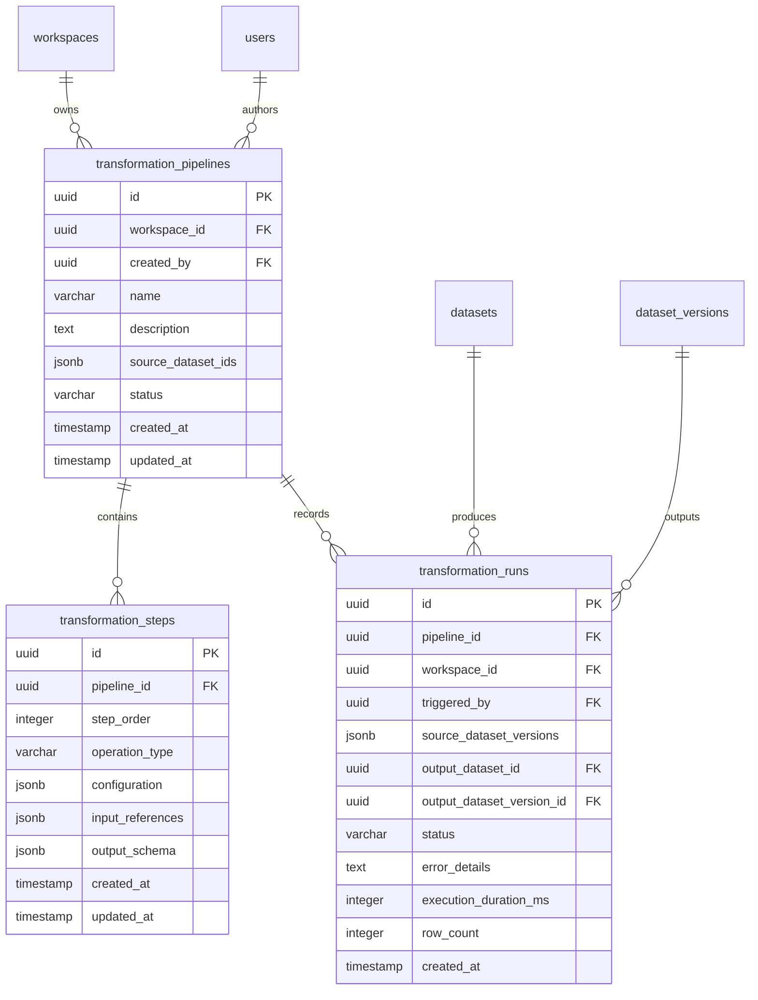

# DataLens — Phase 4B Architecture: Advanced Data Transformation & Data Preparation Engine

## 1. Executive Summary & Objective

DataLens Phase 4B introduces an enterprise **Data Transformation & Preparation Engine** allowing users to combine, clean, enrich, and transform multiple uploaded datasets before downstream analysis in Data Studio, Interactive Dashboards (Phase 4A), Ask Your Data, ML Models, and Reports.

Core architectural tenets:
1. **Source Immutability:** Original uploaded datasets and dataset versions are never altered or mutated.
2. **Deterministic Pipelines:** Ordered transformation steps executed via DuckDB in-memory or streamed execution against Parquet storage.
3. **Derived Dataset Provenance:** Successful pipeline executions generate real first-class `Dataset` and `DatasetVersion` entities with full lineage tracking back to the source datasets and pipeline run ID.
4. **Secure Formula Evaluation:** Zero `eval()` or arbitrary code execution; AST-validated arithmetic, conditional, and string expressions transpiled strictly to safe DuckDB expressions.
5. **Zero Cross-Workspace Leakage:** Multi-tenant workspace enforcement guarantees no cross-workspace joins, appends, or dataset references.

---

## 2. Reusable Architecture & Component Audit

### 2.1 Backend Foundation
- **DuckDB Analytics (`app.services.analytics.engine.AnalyticsEngine`):**
  - High-throughput analytical SQL queries over partitioned Parquet files using sanitized identifiers and parameterized clauses.
  - Provides source reading via `_get_parquet_source_sql()`.
- **Dataset Storage (`app.services.dataset_service` & `settings.STORAGE_ROOT`):**
  - Immutable file storage holding partitioned Parquet chunks and JSON manifests (`parts`, `columns`, `row_count`).
  - Derived datasets will be written as clean partitioned Parquet files and registered into the PostgreSQL catalog.
- **Workspace Scoping & RBAC (`app.dependencies.auth`):**
  - `require_workspace_role(["owner", "admin", "editor"])` for creating, modifying, and executing pipelines.
  - `require_workspace_role(["owner", "admin", "editor", "viewer"])` for viewing pipeline definitions and running step previews.

### 2.2 Frontend Foundation
- **UI System:** Deep Navy (`#102C46`), Peacock Teal (`#009F98`), Light Teal (`#39C3B8`), Ice Grey (`#F5F8FA`).
- **Atoms & Navigation:** `Button`, `Modal`, `Badge`, `Card`, `Sidebar` navigation, `apiClient`.
- **Components:** Interactive step cards, column selector dropdowns, schema tables, preview grids.

---

## 3. Entity-Relationship Data Model (Stage 1)

---

## 4. Transformation Operations & Engine Specification

| Operation Type | Sub-type / Engine | Configuration Parameters | DuckDB Execution Logic |
| :--- | :--- | :--- | :--- |
| **JOIN** | `inner`, `left`, `right`, `full_outer` | `left_dataset_id`, `right_dataset_id`, `join_conditions` `[{left_col, right_col}]`, `output_columns`, `conflict_resolution` | `SELECT ... FROM left_src [TYPE] JOIN right_src ON ...` with column aliasing |
| **APPEND** | `union_all`, `union_distinct` | `dataset_ids`, `column_mapping` | `SELECT ... FROM src_1 UNION ALL SELECT ... FROM src_2` with schema union |
| **CLEAN_NULLS** | `drop`, `fill_constant`, `fill_mean`, `fill_median`, `fill_mode`, `ffill`, `bfill` | `columns`, `strategy`, `fill_value` | `WHERE col IS NOT NULL` or `COALESCE(col, mean_subquery)` |
| **CLEAN_DUPLICATES** | `drop_duplicates` | `subset_columns`, `keep` (`first`/`last`) | `ROW_NUMBER() OVER (PARTITION BY ... ORDER BY ...) = 1` |
| **TYPE_CAST** | `cast` | `column`, `target_type` (`int`, `float`, `date`, `varchar`, `boolean`), `date_format` | `TRY_CAST(col AS TYPE)` or `strptime(col, format)` |
| **STRING_OP** | `trim`, `lower`, `upper`, `replace`, `split`, `concat` | `column`, `op`, `search_str`, `replace_str`, `split_delim`, `split_part`, `concat_columns`, `new_column_name` | `TRIM()`, `LOWER()`, `REPLACE()`, `string_split()` |
| **FORMULA** | `calculated_column` | `new_column_name`, `formula_expression`, `output_type` | AST-validated expression transpilation (e.g. `(sales - cost) / NULLIF(cost, 0)`) |
| **FILTER** | `filter_rows` | `conditions` `[{column, operator, value}]` | Parameterized `WHERE` clause builder |
| **SELECT_COLUMNS** | `select_or_rename` | `columns_to_keep`, `renames` `{old_col: new_col}` | `SELECT old_col AS new_col, ...` |

---

## 5. Secure Formula Engine (Stage 5)

To guarantee security against SQL injection and remote code execution:
1. **Lexical Tokenizer:** Breaks formulas into strict token types (`IDENTIFIER`, `NUMBER`, `STRING_LITERAL`, `OPERATOR`, `PUNCTUATION`).
2. **Grammar Validator:** Validates balanced parentheses, valid operator placements, and registered functions only:
   - Arithmetic: `+`, `-`, `*`, `/`, `%`
   - Comparisons: `>`, `<`, `>=`, `<=`, `==`, `!=`
   - Logical: `AND`, `OR`, `NOT`
   - Functions: `IF`, `CASE`, `COALESCE`, `CONCAT`, `UPPER`, `LOWER`, `TRIM`, `ROUND`, `ABS`, `DATE_PART`, `DATEDIFF`
3. **Column Verification:** Checks all identifier tokens against the schema of the current pipeline step. Unknown column names fail immediately with descriptive errors.
4. **Safe Transpilation:** Transpiles to safe DuckDB SQL dialect with identifier quoting (`"col_name"`) and zero `eval()`. Division automatically wraps the denominator in `NULLIF(..., 0)` to prevent runtime division by zero crashes.

---

## 6. Pipeline Execution & Lineage (Stage 7 & 8)

When the user clicks **Run Pipeline**:
1. Pipeline steps are verified in sequential order.
2. An isolated DuckDB session executes each step sequentially, creating temporary in-memory tables `step_1_tbl`, `step_2_tbl`, etc.
3. The final step's result is written directly to disk as a production Parquet file:
   `storage_data/datasets/{workspace_id}/{derived_dataset_id}/{derived_version_id}/processed/data_0.parquet`
4. Manifest metadata is compiled (`row_count`, `column_count`, schema with types).
5. A new `Dataset` is inserted with `is_derived=True` and linked to `DatasetVersion(version_number="v1")`.
6. A `TransformationRun` is logged linking the source datasets, source dataset version IDs, output dataset ID, step counts, duration, and user ID.
7. The new dataset appears immediately in Data Studio, Dashboards, Ask Your Data, and ML registries.

