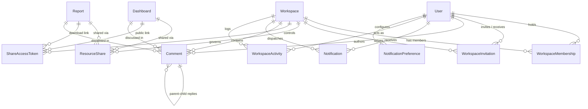

# DataLens Phase 5B: Architecture & Technical Specification
## Team Collaboration, Workspace Sharing & Communication Platform

## 1. System Objective

Phase 5B transforms DataLens from a single-analyst workbench into an enterprise-grade collaborative Business Intelligence platform. It enables multiple team members to safely collaborate within shared workspaces, discuss analytical findings, share dashboards and reports with granular permissions, receive real-time notifications, and audit all workspace operations through an immutable activity feed.

---

## 2. Architecture & Domain Entity Relationship Diagram

---

## 3. Database Models & Schema Extensions

### A. Extended WorkspaceInvitation (`workspace_invitations`)
- `status`: String(20) enum: `'pending'`, `'accepted'`, `'declined'`, `'expired'`, `'revoked'`
- `token_hash`: String(64) SHA-256 of the random invitation token
- `declined_at`: DateTime nullable
- `revoked_at`: DateTime nullable
- `resend_count`: Integer default 0

### B. ResourceShare (`resource_shares`)
- Manages explicit internal sharing with specific workspace members.
- `id`: UUID Primary Key
- `workspace_id`: Foreign Key (`workspaces.id`, CASCADE)
- `resource_type`: String(50) (`dashboard` or `report`)
- `resource_id`: UUID
- `shared_with_user_id`: Foreign Key (`users.id`, CASCADE)
- `shared_by_user_id`: Foreign Key (`users.id`, SET NULL)
- `permission`: String(20) (`viewer` or `editor`)
- `created_at`, `updated_at`
- Unique constraint: `(workspace_id, resource_type, resource_id, shared_with_user_id)`

### C. ShareAccessToken (`share_access_tokens`)
- Manages external and public link-based sharing with token hashing, expiration, and optional password protection.
- `id`: UUID Primary Key
- `workspace_id`: Foreign Key (`workspaces.id`, CASCADE)
- `resource_type`: String(50) (`dashboard` or `report`)
- `resource_id`: UUID
- `token_hash`: String(64) SHA-256
- `password_hash`: String(255) Nullable (bcrypt / pbkdf2)
- `permission`: String(20) default `'viewer'`
- `allow_download`: Boolean default True
- `expires_at`: DateTime Nullable
- `is_revoked`: Boolean default False
- `access_count`: Integer default 0
- `last_accessed_at`: DateTime Nullable
- `created_by`: Foreign Key (`users.id`, SET NULL)
- `created_at`: DateTime

### D. Comment & Discussion System (`comments`)
- Threaded commenting on dashboards and reports.
- `id`: UUID Primary Key
- `workspace_id`: Foreign Key (`workspaces.id`, CASCADE)
- `resource_type`: String(50) (`dashboard` or `report`)
- `resource_id`: UUID
- `parent_id`: UUID Foreign Key (`comments.id`, CASCADE, Nullable)
- `author_id`: Foreign Key (`users.id`, CASCADE)
- `content`: Text (sanitized markdown/text)
- `mentions`: JSONB (list of mentioned user UUIDs or usernames)
- `is_resolved`: Boolean default False
- `resolved_by_id`: Foreign Key (`users.id`, SET NULL, Nullable)
- `resolved_at`: DateTime Nullable
- `is_deleted`: Boolean default False
- `created_at`, `updated_at`: DateTime

### E. Notification System (`notifications`)
- In-app notification delivery.
- `id`: UUID Primary Key
- `workspace_id`: Foreign Key (`workspaces.id`, CASCADE)
- `recipient_id`: Foreign Key (`users.id`, CASCADE)
- `actor_id`: Foreign Key (`users.id`, SET NULL, Nullable)
- `event_type`: String(50) (e.g. `invitation`, `role_changed`, `dashboard_shared`, `report_shared`, `mention`, `comment_reply`)
- `resource_type`: String(50) Nullable
- `resource_id`: UUID Nullable
- `title`: String(255)
- `message`: Text
- `data`: JSONB (metadata payload)
- `is_read`: Boolean default False
- `read_at`: DateTime Nullable
- `created_at`: DateTime

### F. NotificationPreference (`notification_preferences`)
- Per-user notification settings.
- `id`: UUID Primary Key
- `user_id`: Foreign Key (`users.id`, CASCADE)
- `workspace_id`: Foreign Key (`workspaces.id`, CASCADE)
- `email_notifications`: Boolean default True
- `in_app_notifications`: Boolean default True
- `mention_notifications`: Boolean default True
- `share_notifications`: Boolean default True
- Unique constraint: `(user_id, workspace_id)`

### G. WorkspaceActivity (`workspace_activities`)
- Unified workspace audit trail and activity logging.
- `id`: UUID Primary Key
- `workspace_id`: Foreign Key (`workspaces.id`, CASCADE)
- `actor_id`: Foreign Key (`users.id`, SET NULL, Nullable)
- `event_type`: String(50)
- `resource_type`: String(50)
- `resource_id`: UUID Nullable
- `summary`: String(500)
- `metadata_snapshot`: JSONB (zero secrets)
- `created_at`: DateTime

---

## 4. API Endpoints Specification

### Workspace & Team Members
- `GET /api/v1/workspaces/{workspace_id}/members` – List all members and roles.
- `PATCH /api/v1/workspaces/{workspace_id}/members/{user_id}` – Update member role.
- `DELETE /api/v1/workspaces/{workspace_id}/members/{user_id}` – Remove member or leave workspace.
- `GET /api/v1/workspaces/{workspace_id}/invitations` – List invitations with status filters.
- `POST /api/v1/workspaces/{workspace_id}/invitations` – Send new invitation.
- `POST /api/v1/workspaces/{workspace_id}/invitations/{invitation_id}/resend` – Resend invitation.
- `DELETE /api/v1/workspaces/{workspace_id}/invitations/{invitation_id}` – Revoke invitation.
- `GET /api/v1/invitations/{token}` – Inspect invitation validity and metadata.
- `POST /api/v1/invitations/{token}/accept` – Accept invitation.
- `POST /api/v1/invitations/{token}/decline` – Decline invitation.

### Resource Sharing (Dashboards & Reports)
- `GET /api/v1/dashboards/{dashboard_id}/shares` – List member shares & public links.
- `POST /api/v1/dashboards/{dashboard_id}/shares` – Share dashboard with member.
- `DELETE /api/v1/dashboards/{dashboard_id}/shares/{share_id}` – Revoke member share.
- `POST /api/v1/dashboards/{dashboard_id}/links` – Create secure external share link.
- `DELETE /api/v1/dashboards/{dashboard_id}/links/{link_id}` – Revoke share link.
- `POST /api/v1/dashboards/{dashboard_id}/duplicate` – Clone dashboard into workspace.
- `GET /api/v1/reports/{report_id}/shares` – List report shares.
- `POST /api/v1/reports/{report_id}/shares` – Share report with member.
- `DELETE /api/v1/reports/{report_id}/shares/{share_id}` – Revoke report share.
- `POST /api/v1/reports/{report_id}/links` – Create secure expiring report link.
- `DELETE /api/v1/reports/{report_id}/links/{link_id}` – Revoke report link.

### Public / Controlled Share Resolvers
- `GET /api/v1/shared/dashboards/{token}` – View dashboard via secure link (validates expiration & password).
- `POST /api/v1/shared/dashboards/{token}/query` – Execute widget queries within authorized scope.
- `GET /api/v1/shared/reports/{token}/download` – Download report document via secure link.

### Comments & Discussions
- `GET /api/v1/comments` – List comment threads for resource.
- `POST /api/v1/comments` – Create comment or reply (dispatches mention notifications).
- `PUT /api/v1/comments/{comment_id}` – Edit author's own comment.
- `DELETE /api/v1/comments/{comment_id}` – Soft delete comment.
- `POST /api/v1/comments/{comment_id}/resolve` – Mark discussion thread as resolved.
- `POST /api/v1/comments/{comment_id}/reopen` – Reopen discussion thread.

### Notification Center
- `GET /api/v1/notifications` – List user notifications (paginated).
- `GET /api/v1/notifications/unread-count` – Fast unread count badge.
- `PATCH /api/v1/notifications/{id}/read` – Mark single notification read.
- `POST /api/v1/notifications/mark-all-read` – Mark all workspace notifications read.
- `DELETE /api/v1/notifications/{id}` – Dismiss notification.
- `GET /api/v1/notifications/preferences` – Get notification preferences.
- `PUT /api/v1/notifications/preferences` – Update notification preferences.
- `GET /api/v1/notifications/stream` – Server-Sent Events (SSE) live updates stream.

### Activity Feed
- `GET /api/v1/workspaces/{workspace_id}/activity` – Timeline of workspace events with pagination and filters.

---

## 5. Security & RBAC Enforcement

1. **Workspace Boundary**: Every resource, share, discussion, and notification is strictly bound by `workspace_id`.
2. **Token Security**: Tokens are generated using `secrets.token_urlsafe(32)` (256-bit entropy) and stored exclusively as SHA-256 hashes (`token_hash`).
3. **Password Protection**: Passwords on public links are salted and hashed via Argon2/Bcrypt.
4. **Data Masking**: Activity feeds and logs omit raw secrets, credentials, or confidential dataset values.
5. **Anti-IDOR**: Access to dashboards, reports, and comments requires verified workspace membership or an active, unexpired, unrevoked share token.

