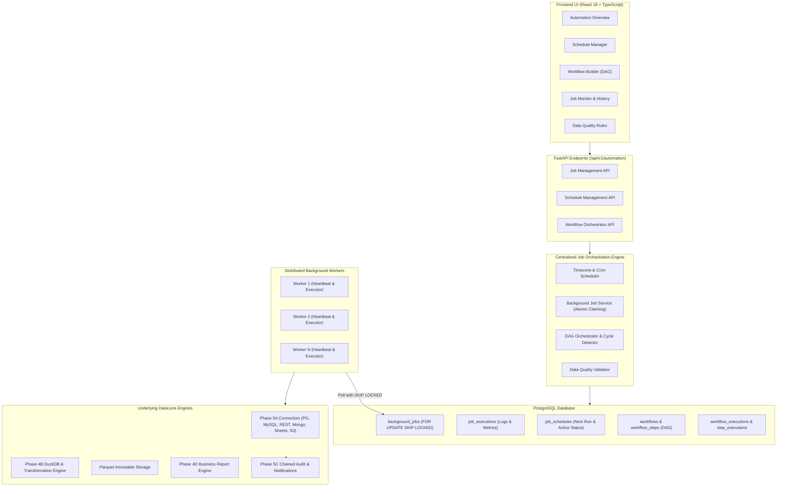
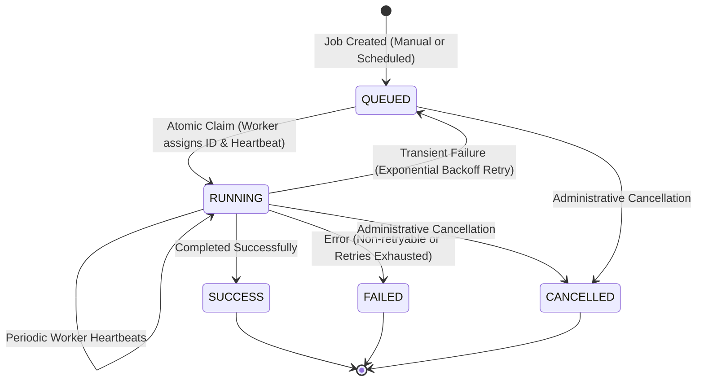

# DataLens Phase 5D – System Architecture & Technical Specification
## Automated Data Refresh, Pipeline Orchestration & Background Job Management

---

### Executive Overview

Phase 5D transforms DataLens into an automated, enterprise-grade Business Intelligence platform. It provides a fault-tolerant, horizontally scalable, database-backed background job orchestration engine, a timezone-aware scheduling engine, automated external connector refreshes, end-to-end transformation and validation pipelines (DAG workflows), and comprehensive operational monitoring.

---

### 1. Architectural Principles

1. **Database-Backed Reliability (PostgreSQL Native):**
   - All job state, worker leases, schedules, and DAG steps reside durably in PostgreSQL.
   - Atomic job claiming uses PostgreSQL `SELECT ... FOR UPDATE SKIP LOCKED` to prevent race conditions across multiple concurrent worker processes without external queue dependencies (no Celery/Redis requirement).
   - Survives process restarts: jobs in `QUEUED` remain ready; orphaned `RUNNING` jobs with expired heartbeats are automatically reclaimed or failed safely.

2. **Idempotency & Immutability:**
   - Every background job supports an `idempotency_key` ensuring duplicate triggers never produce duplicate runs or duplicate dataset versions.
   - Datasets remain immutable: derived pipeline runs and refreshes materialize new immutable `DatasetVersion` entities with complete audit lineage.

3. **Timezone-Aware Scheduling:**
   - Supports one-time, hourly, daily, weekly, monthly, and standard 5-field cron schedules (`minute hour dom month dow`).
   - All internal timestamps are stored strictly in UTC. Schedule calculations interpret the user's localized timezone, accounting for Daylight Saving Time (DST) transitions.

4. **Directed Acyclic Graph (DAG) Workflow Orchestration:**
   - Workflows chain steps: `Source Refresh` $\to$ `Data Validation` $\to$ `Transformation Pipeline` $\to$ `Dataset Materialization` $\to$ `Report Generation & Delivery`.
   - Explicit dependency graphs (`depends_on_step_ids`) with strict cycle detection (Tarjan's / Kahn's topological sort) before activation.
   - Configurable failure policies: `STOP_IMMEDIATELY`, `RETRY_FAILED_STEP`, `CONTINUE_INDEPENDENT_BRANCHES`, `REQUIRE_MANUAL_INTERVENTION`.

5. **Data Quality Gateways:**
   - Pre-materialization validation evaluates required columns, data types, null percentage thresholds, duplicate row bounds, and row-count constraints.
   - Configurable enforcement actions: `BLOCK`, `WARN`, `REQUIRE_APPROVAL`.

6. **Enterprise Governance & Zero-Secret Redaction:**
   - Authentication tokens, passwords, and private connection credentials are automatically stripped or masked (`••••••••`) from job payloads and execution logs.
   - Integrates with Phase 5B notifications and Phase 5C tamper-evident chained audit trails.

---

### 2. Architecture Diagram

---

### 3. Background Job Lifecycle State Machine

---

### 4. Database Schema Specification

| Table Name | Primary Purpose | Key Fields & Indexes |
|---|---|---|
| `background_jobs` | Central job queue & lifecycle tracker | `id` (UUID), `workspace_id`, `job_type`, `status`, `priority`, `idempotency_key` (UNIQUE), `scheduled_at`, `started_at`, `worker_id`, `heartbeat_at`, `retry_count`, `max_retries` |
| `job_executions` | Execution attempt history & structured logs | `id` (UUID), `job_id`, `attempt_number`, `status`, `duration_ms`, `error_classification`, `logs` (JSONB), `metrics` (JSONB) |
| `job_schedules` | Timezone-aware recurring schedules | `id` (UUID), `workspace_id`, `job_type`, `target_resource_id`, `frequency`, `cron_expression`, `timezone`, `next_run_at`, `is_active` |
| `workflows` | Workflow definition (DAG metadata) | `id` (UUID), `workspace_id`, `name`, `failure_policy`, `is_active`, `created_by` |
| `workflow_steps` | Individual workflow step definitions | `id` (UUID), `workflow_id`, `step_name`, `step_order`, `step_type`, `target_resource_id`, `configuration`, `depends_on_step_ids` (JSONB) |
| `workflow_executions` | Historical workflow execution instance | `id` (UUID), `workflow_id`, `workspace_id`, `status`, `started_at`, `finished_at`, `duration_ms` |
| `workflow_step_executions` | Step-level execution tracking & metrics | `id` (UUID), `workflow_execution_id`, `step_id`, `status`, `job_id`, `input_version_ids`, `output_version_ids`, `metrics` |

---

### 5. API Route Architecture

- `GET /api/v1/automation/overview`: Summary metrics (active schedules, queued/running/failed jobs, system health).
- `POST /api/v1/automation/jobs`: Enqueue an ad-hoc background job.
- `GET /api/v1/automation/jobs`: List jobs with status, type, and workspace filters.
- `GET /api/v1/automation/jobs/{job_id}`: Job detail and execution history.
- `POST /api/v1/automation/jobs/{job_id}/cancel`: Atomically cancel a queued or running job.
- `POST /api/v1/automation/jobs/{job_id}/retry`: Manually re-enqueue a failed or cancelled job.
- `GET /api/v1/automation/schedules`: List recurring schedules.
- `POST /api/v1/automation/schedules`: Create a recurring or one-time schedule.
- `PUT /api/v1/automation/schedules/{schedule_id}`: Update schedule frequency, cron, or timezone.
- `POST /api/v1/automation/schedules/{schedule_id}/pause`: Pause schedule.
- `POST /api/v1/automation/schedules/{schedule_id}/resume`: Resume schedule.
- `DELETE /api/v1/automation/schedules/{schedule_id}`: Delete schedule.
- `GET /api/v1/automation/workflows`: List DAG workflows.
- `POST /api/v1/automation/workflows`: Create workflow with steps.
- `PUT /api/v1/automation/workflows/{workflow_id}`: Update workflow and steps.
- `POST /api/v1/automation/workflows/{workflow_id}/validate`: Cycle and dependency check.
- `POST /api/v1/automation/workflows/{workflow_id}/trigger`: Ad-hoc workflow execution trigger.
- `GET /api/v1/automation/workflows/{workflow_id}/executions`: List workflow run history.
- `GET /api/v1/automation/executions/{execution_id}`: Detailed step-by-step DAG execution breakdown.

