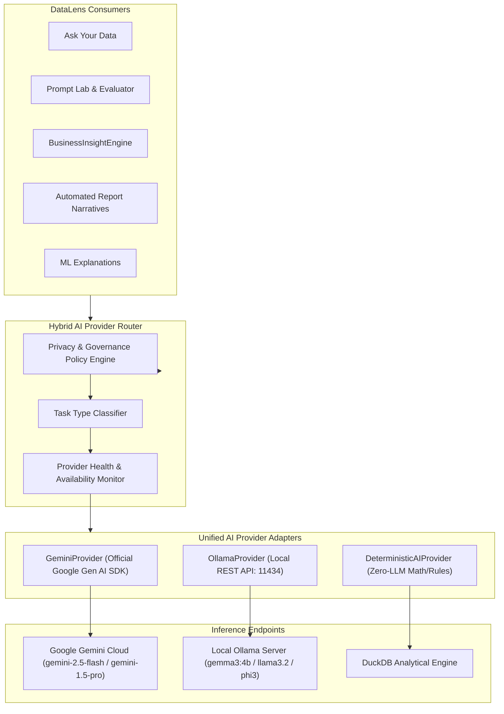

# DataLens Phase 6A – System Architecture & Technical Specification
## Unified AI Architecture: Google Gemini + Local AI (Ollama) + Hybrid Provider Routing

---

### Executive Overview

Phase 6A unifies DataLens artificial intelligence capabilities into an extensible, provider-agnostic architecture. It decouples high-level analytical features (Ask Your Data, Prompt Lab, Automated Reporting Narratives, ML Insights) from underlying vendor SDKs and introduces first-class support for locally hosted AI models via Ollama (`http://localhost:11434`), alongside enterprise Google Gemini cloud models.

---

### 1. Architectural Principles

1. **Provider Independence:**
   - All modules consume a unified `AIProvider` contract offering `generate_text()`, `generate_structured_output()`, `generate_analysis_plan()`, `explain_results()`, `evaluate_response()`, and `health_check()`.
   - Adding future providers (e.g. Anthropic, vLLM, Azure OpenAI) requires only implementing an adapter adhering to this interface.

2. **Zero-Secret & Privacy First:**
   - Raw dataset rows are **never** transmitted to cloud providers.
   - Datasets classified with sensitivity tiers `CONFIDENTIAL` or `RESTRICTED` are strictly bound to local or deterministic execution.
   - PII, passwords, connection credentials, and authentication tokens are scrubbed (`••••••••`) before prompts are constructed.

3. **Intelligent Hybrid Routing:**
   - **`HYBRID` Mode:** Directs routine tasks (schema interpretation, basic SQL, sensitive queries) to local Ollama models while routing complex business reasoning, multi-dataset synthesis, and executive narratives to Google Gemini.
   - **`GEMINI_ONLY` Mode:** Directs all non-sensitive analytical requests to Google Gemini cloud.
   - **`LOCAL_ONLY` Mode:** Air-gapped / sovereign compliance mode where zero AI traffic leaves the local infrastructure.
   - **`DETERMINISTIC_ONLY` Mode:** Complete offline operation with rule-based heuristics and mathematical calculation.

4. **Graceful Fallback Chains:**
   - If Google Gemini experiences quota limits (HTTP 429) or transient timeouts, the router falls back to Ollama if permitted by privacy policies.
   - If Ollama is offline or the requested local model is not pulled, the router falls back to Gemini (if privacy permits) or safely transitions to deterministic analytics without crashing user flows.

---

### 2. Unified Architecture Diagram

---

### 3. Task-Based Routing Matrix in HYBRID Mode

| Analytical Task Type | Default Provider | Privacy Requirement | Fallback If Unavailable |
|---|---|---|---|
| Natural Language $\to$ Analysis Plan | Local AI (Ollama) | Metadata Only | Cloud AI (Gemini) $\to$ Heuristic |
| Dataset Schema Explanation | Local AI (Ollama) | Metadata Only | Cloud AI (Gemini) $\to$ Heuristic |
| Simple Analytical Summary | Local AI (Ollama) | Aggregated Metrics | Cloud AI (Gemini) $\to$ Deterministic |
| Complex Business Reasoning | Cloud AI (Gemini) | Aggregated Metrics | Local AI (Ollama) $\to$ Deterministic |
| Executive Report Narratives | Cloud AI (Gemini) | Aggregated Metrics | Local AI (Ollama) $\to$ Template Rules |
| Sensitive / Restricted Dataset Query | Local AI (Ollama) | Local Only (Strict) | Deterministic Only (Cloud Barred) |
| Prompt Lab Evaluation / Judge | Cloud AI (Gemini) | Non-Sensitive | Local AI (Ollama) $\to$ Heuristic |

