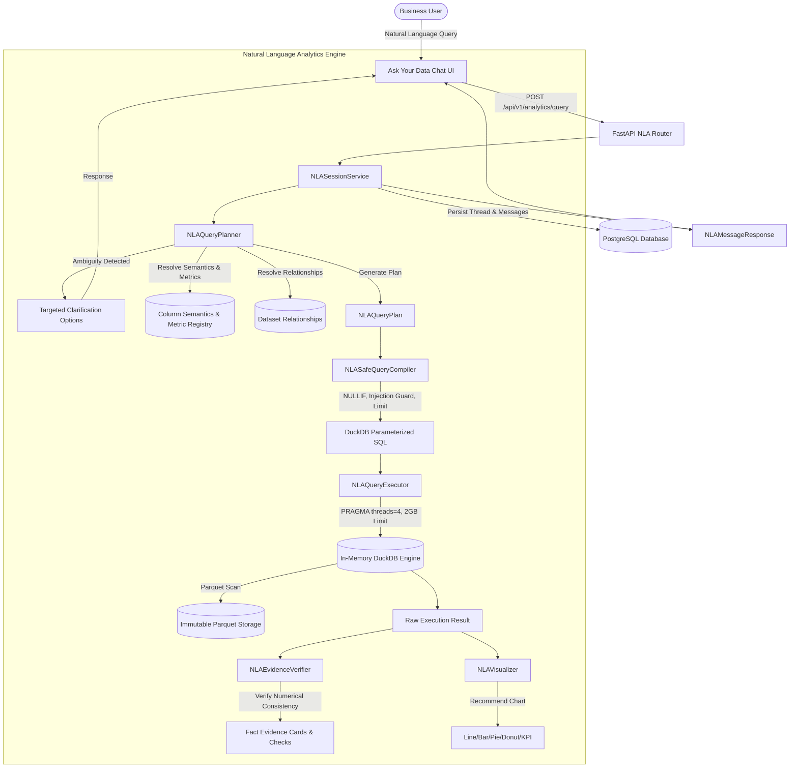

# Phase 6C Architecture: Natural Language Analytics Engine & Conversational BI

## Executive Summary
DataLens Phase 6C delivers an enterprise natural-language analytics engine and conversational business intelligence platform. The architecture transforms DataLens from static dashboarding into an intelligent business analyst that understands complex questions, grounds intent in semantic mappings and approved business metrics, compiles secure DuckDB queries over Parquet data, executes calculations deterministically, and provides evidence-backed explanations.

## Architectural Components

### 1. Conversational Query Routing & Session Persistence
- **API Router**: `/api/v1/analytics/query`, `/clarify`, `/follow-up`, `/sessions`, `/saved`.
- **Database Models**:
  - `NLASession`: Persists conversation threads tied to workspaces and primary datasets.
  - `NLAMessage`: Persists messages, query plans, raw SQL, result cards, and execution metrics.
  - `SavedAnalysis`: Allows analysts to bookmark and share high-value analytical findings.

### 2. Semantic-Aware Analytical Query Planner (`NLAQueryPlanner`)
- Resolves intent (`performance`, `ranking`, `comparison`, `trend`, `contribution`, `diagnostic`).
- Maps business terms to registered `MetricDefinition` records and `ColumnSemanticMapping` entries.
- Employs conversational memory to preserve context across multi-turn follow-ups (e.g. "Now only for North").
- Detects ambiguous questions and returns targeted clarification options.

### 3. Safe Query Compilation Engine (`NLASafeQueryCompiler`)
- Employs whitelist identifier sanitization (`sanitize_identifier`) to block SQL injection.
- Generates parameterized DuckDB SQL with safe equality, range, and pattern filters.
- Enforces division-by-zero protection via `NULLIF(denominator, 0)`.
- Restricts queries to immutable Parquet datasets with deterministic timeouts (30s) and row bounds (`LIMIT 1000`).

### 4. Deterministic Query Execution (`NLAQueryExecutor`)
- In-memory DuckDB connection with strict memory limits (`PRAGMA memory_limit='2GB'`) and thread controls (`PRAGMA threads=4`).
- Computes execution duration, row counts, and structured dictionary rows.

### 5. Evidence-Backed Numerical Verification (`NLAEvidenceVerifier`)
- Separates computed facts, AI explanations, business inferences, and recommendations.
- Validates all numbers cited in AI narratives against DuckDB execution outputs, catching hallucinations.

### 6. Intelligent Visualization Engine (`NLAVisualizer`)
- Analyzes cardinality, dimensional shapes, and analytical intents to recommend line, bar, pie, donut, or KPI cards.
- Provides synchronized tabular views and CSV export capabilities.

