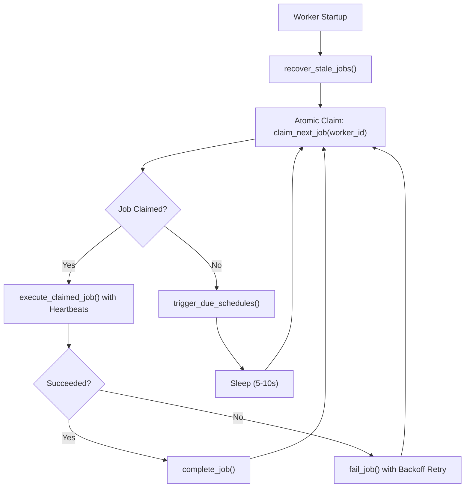

# DataLens Phase 5D – Background Worker Operations & Deployment Guide

---

## 1. Overview

The background job worker operates as an asynchronous worker process or concurrent loop embedded within the DataLens backend service or deployed as dedicated standalone worker instances.

---

## 2. Worker Lifecycle & Architecture

---

## 3. Worker Configuration Variables

| Environment Variable | Default Value | Description |
|---|---|---|
| `DATALENS_WORKER_CONCURRENCY` | `4` | Number of simultaneous background jobs per worker process. |
| `DATALENS_JOB_HEARTBEAT_SEC` | `15` | Interval between worker heartbeat database updates. |
| `DATALENS_STALE_JOB_TIMEOUT_SEC` | `600` | Inactivity threshold before a crashed worker's job is reclaimed. |
| `DATALENS_POLL_INTERVAL_SEC` | `5` | Idle sleep duration between job polling cycles. |
| `DATALENS_DEFAULT_MAX_RETRIES` | `3` | Default retry attempts for transient job failures. |

---

## 4. Multi-Worker Scaling & High Availability

- Multiple worker instances run concurrently across separate processes, containers, or Kubernetes pods.
- PostgreSQL `FOR UPDATE SKIP LOCKED` guarantees that no two workers ever claim or execute the same job concurrently.
- No central scheduler coordinator lock is required, eliminating single-point-of-failure bottlenecks.

